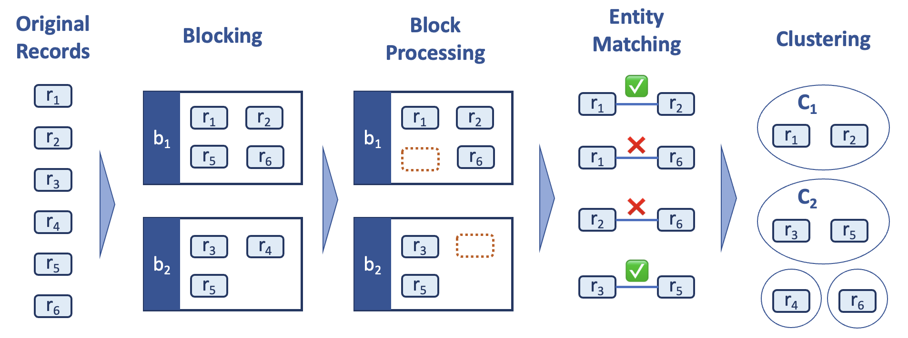

# SERF: Semantic Entity Resolution Framework

[](LICENSE)
[](https://python.org)

SERF is an open-source Python framework for **semantic entity resolution and canonicalization** (match and merge). It combines a 33M-parameter CPU embedding blocker (`BAAI/bge-small-en-v1.5` + FAISS) with DSPy-orchestrated Large Language Models (LLMs) for whole-block entity matching, schema alignment, and field-level canonical record merging.

With **just an open-weight 120B model (`openai/gpt-oss-120b-maas`) and DSPy GEPA reflective prompt optimization**—and zero LLM weight fine-tuning—SERF reaches a **94.92% five-dataset mean F1 on disjoint holdout splits** across the standard Leipzig / DeepMatcher benchmarks (**98.49%** on DBLP-ACM, **95.77%** on DBLP-Scholar, **95.33%** on Walmart-Amazon, **95.17%** on Abt-Buy, and **89.82%** on Amazon-Google), matching or surpassing published fine-tuned cross-encoders and end-to-end pipelines while enforcing **100% identifier conservation**.

<div align="center">
  
  <p><em>Source: <a href="https://medium.com/data-science/entity-resolution-identifying-real-world-entities-in-noisy-data-3e8c59f4f41c">Entity Resolution: Identifying Real-World Entities in Noisy Data</a></em></p>
</div>

---

## Why SERF?

Entity resolution across heterogeneous data sources is notoriously difficult:

- **Quadratic complexity ($O(N^2)$)** makes naive pairwise comparisons intractable at scale.
- **Rule-based heuristics and fuzzy joins** are brittle and require endless manual tuning.
- **Pure embedding similarity** works for coarse semantic grouping but fails to distinguish fine-grained differences (e.g., product model numbers, storage capacities, edition years).

SERF solves this by combining the speed of dense vector search with the reasoning capabilities of LLMs in a modular, multi-iteration pipeline:

1. **Semantic Blocking**: Dense embeddings (`BAAI/bge-small-en-v1.5`) and FAISS IVF index cluster records into small candidate blocks, filtering out 99%+ of non-matches without quadratic blowup.
2. **Whole-Block Partition Matching**: Rather than evaluating pairwise links independently, the LLM views all records in a candidate block simultaneously and outputs entity partitions (clusters). This prevents contradictory pairwise decisions (e.g., $A=B$, $B=C$, but $A \neq C$).
3. **Auditable Canonical Records**: Merged entities receive newly minted UUIDs while preserving full transitive lineage (`source_uuids`). Multi-valued attributes are deduplicated using type-aware semantic policies.
4. **Multi-Round Iterative Resolution**: Resolved entities are re-blocked and matched over multiple iterations. Records separated in the first round of coarse blocking get additional opportunities to merge.
5. **Prompt Optimization with GEPA**: Self-improving matching signatures powered by DSPy's Generative Prompt Optimization (GEPA), with strict train/validation/holdout data separation.

---

## Architecture & Data Flow

```text
Raw Records
    │
    ▼
[ 1. Semantic Blocking ] ──> Dense vector embeddings + FAISS IVF
    │                        Groups records into manageable blocks (e.g., 30–50 records)
    ▼
[ 2. Partition Matching ] ──> DSPy + LLM (XMLAdapter)
    │                         Partitions each block into resolved entity clusters
    ▼
[ 3. Canonical Merging ]  ──> Mints new UUIDs, records complete source lineage,
    │                         and deduplicates attributes by field semantics
    ▼
[ 4. Multi-Round Loop ]   ──> Re-blocks surviving canonical records for N iterations
    │
    ▼
Resolved Knowledge Graph
```

| Component           | Technology                                                                             |
| ------------------- | -------------------------------------------------------------------------------------- |
| **Package Manager** | [uv](https://docs.astral.sh/uv/)                                                       |
| **Data Processing** | [PySpark 4.x](https://spark.apache.org/) (optional distributed ETL & graph operations) |
| **LLM Framework**   | [DSPy](https://dspy.ai/) with `XMLAdapter` for structured XML/Pydantic outputs         |
| **Embeddings**      | `BAAI/bge-small-en-v1.5` via [Sentence-Transformers](https://sbert.net/)               |
| **Vector Indexing** | [FAISS](https://github.com/facebookresearch/faiss) (`IndexIVFFlat`)                    |
| **Prompt Tuning**   | DSPy GEPA (student/teacher reflection optimization)                                    |
| **Code Quality**    | Ruff (linting & formatting), zuban / mypy (static type checking)                       |

---

## The Resolved Record Data Model

Entity resolution merges multiple input records into unified canonical entities. To ensure data integrity, auditability, and no information loss, SERF enforces strict record conventions:

1. **UUID-Native Identity**: Every input entity has a UUID. When records merge, SERF mints a new UUID and records all constituent record UUIDs—including transitively merged ones—in `source_uuids`. Unmatched records preserve their original identity.
2. **Singular and List Fields via DSPy Field Annotations**: Every field in an entity schema compiles into a DSPy `Annotated[..., dspy.OutputField(...)]` annotation that tells the LLM how to compare and merge values at the field level:
   - **Singular fields (`cardinality: single`)**: The LLM compares candidate values across matched records and selects the single best, most complete, and accurate value.
   - **List fields (`cardinality: list`)**: The LLM compares values across matched records and deduplicates them into a list of individual values (for example, collapsing spelling or street/unit abbreviation variants into individual addresses or names while keeping distinct addresses or names separate).
3. **Type-Aware Merge Semantics**: Field values carry type-specific merge instructions and policies:

| Field Type                                       | Default Dedupe                  | Field-Level Merge Semantics                                                                                                      |
| ------------------------------------------------ | ------------------------------- | -------------------------------------------------------------------------------------------------------------------------------- |
| `name`, `address`                                | Fuzzy (`dedupe: fuzzy`)         | Collapse spelling, initial, and street/unit abbreviation variants into the most complete form; keep distinct values separate.    |
| `identifier`, `email`, `phone`, `url`, `numeric` | Normalization (`dedupe: exact`) | Collapse case, punctuation, or scheme variants that denote the same value; keep distinct identifiers, phones, or URLs separate. |
| `text`                                           | Preserved (`dedupe: none`)      | Keep all distinct freeform text descriptions as separate list items, or select the most informative text when marked `single`.   |

### Example: Before and After Merging

```python
# Input records
[
    {"uuid": "11111111-...", "name": "Russell Jurney", "state": "CA"},
    {"uuid": "22222222-...", "name": "Russell H. Jurney", "state": "CA", "source_uuids": ["33333333-..."]},
    {"uuid": "44444444-...", "name": "Bob Dorf", "state": "NY"}
]

# Output canonical records
[
    {
        "uuid": "99999999-...",  # Newly minted UUID
        "name": ["Russell H. Jurney"],  # Fuller variant retained
        "state": ["CA"],  # Duplicate values deduplicated
        "source_uuids": ["11111111-...", "22222222-...", "33333333-..."]  # Full lineage preserved
    },
    {
        "uuid": "44444444-...",  # Unmatched record retained unchanged
        "name": ["Bob Dorf"],
        "state": ["NY"],
        "source_uuids": []
    }
]
```

### Declaring Schemas

You can define explicit entity schemas and merge policies in YAML:

```yaml
entity: Person
description: Cleaned person entity with contact details.
fields:
  - name: display_name
    type: name
    cardinality: single
    description: Primary display name, given name first.
    required: true
  - name: aliases
    type: name
    cardinality: list
    description: Known alternate names and aliases.
  - name: addresses
    type: address
    cardinality: list
    description: Street addresses, deduplicated into individual addresses.
  - name: state
    type: address
    description: Two-letter state abbreviation.
    merge:
      dedupe: exact # Exact matching prevents merging "CA" and "GA"
  - name: email
    type: email
    description: Email addresses.
  - name: bio
    type: text
    description: Freeform biography, preserved as array.
```

Inspect schemas, view generated DSPy signatures (`MergePerson`, `MatchAndMergePerson`), and test merge policies directly via the CLI:

```bash
# View resolved field policies, Pydantic models, and DSPy merge signatures
serf schema schemas/person.yml

# Merge records against a schema using DSPy field-level LLM annotations
serf schema schemas/person.yml --merge records.json --use-llm
```

---

## Quick Start

### Installation

Prerequisites:

- **Python 3.12+**
- **Java 11, 17, or 21** (required for PySpark operations)

Install dependencies using `uv`:

```bash
git clone https://github.com/Graphlet-AI/serf.git
cd serf
uv sync --extra dev
```

### Configure API Keys

Set your LLM credentials in a `.env` file or export them in your shell:

```bash
# OpenAI API (for GPT 6 Luna student model)
export OPENAI_API_KEY="your-openai-api-key"

# Gemini API (for Gemini 4 Argon teacher/reflection model)
export GEMINI_API_KEY="your-gemini-api-key"

# Vertex AI / Google Cloud (optional, for Vertex AI MaaS models such as gpt-oss-120b-maas)
export GOOGLE_CLOUD_PROJECT="your-gcp-project"
export VERTEX_AI_TOKEN="your-vertex-token"
```

### Quick Python Example

```python
import asyncio
from serf.block.pipeline import SemanticBlockingPipeline
from serf.match.matcher import EntityMatcher
from serf.merge.canonical import canonicalize_groups

async def main():
    records = [
        {"id": 1, "name": "Apple iPhone 14 Pro 128GB Space Black", "price": "999"},
        {"id": 2, "name": "iPhone 14 Pro, 128 GB, Black", "price": "999.00"},
        {"id": 3, "name": "Samsung Galaxy S23 Ultra 256GB", "price": "1199"}
    ]

    # 1. Block records semantically
    blocking = SemanticBlockingPipeline(target_block_size=50)
    blocks, metrics = blocking.run(records)

    # 2. Match entities in blocks using LLM
    matcher = EntityMatcher()
    resolutions = await matcher.resolve_blocks(blocks)

    # 3. Canonicalize matches into unified records
    canonical_entities = canonicalize_groups(resolutions.groups, records)
    print(canonical_entities)

asyncio.run(main())
```

---

## CLI Reference

SERF provides a comprehensive Click CLI for running pipelines, evaluating benchmarks, and tuning prompts.

### 1. Core Entity Resolution Pipeline

```bash
# Run the complete end-to-end ER pipeline on your data
serf resolve --input data/entities.csv --output data/resolved/ --iteration 3

# Run individual pipeline stages
serf block --input data/entities.csv --output data/blocks/ --method semantic
serf match --input data/blocks/ --output data/matches/
serf eval --input data/matches/
serf edges --input data/graph_edges.parquet --output data/resolved_edges/
```

### 2. Benchmarks & Evaluation

SERF includes built-in loaders and evaluation runners for standard Leipzig entity resolution benchmarks (`dblp-acm`, `abt-buy`, `walmart-amazon`, `amazon-google`, `dblp-scholar`):

```bash
# Download a benchmark dataset
serf download --dataset dblp-acm

# Run end-to-end benchmark evaluation
serf benchmark --dataset dblp-acm --output data/results/

# Run benchmark with multi-iteration re-blocking (default is 3 iterations)
serf benchmark --dataset dblp-acm --max-iterations 3

# Benchmark with union blocking (name + JSON representation for high product recall)
serf benchmark --dataset amazon-google --blocking-strategy union

# Profile dataset attributes and match discriminativeness with Spark SQL
serf profile-benchmark --dataset abt-buy --output data/abt_buy_profile.md
```

### 3. Prompt Optimization with DSPy GEPA

SERF uses GEPA to iteratively optimize DSPy matching signatures, using a student LM (`openai/gpt-6-luna`) guided by a reflection teacher LM (`gemini/gemini-4-argon` at `medium` reasoning effort):

```bash
# Inspect generated DSPy signatures and rendered prompts
serf prompts --dataset abt-buy

# Train a benchmark dataset's prompt with GEPA and a contrastive fine-tuned blocker
serf train --dataset dblp-acm \
  --blocking-model data/models/fine-tuned-dblp-acm-bge-small-contrastive \
  --num-threads 16

# Evaluate the trained prompt on the disjoint holdout split
serf benchmark --dataset dblp-acm --signature-mode per-dataset \
  --trained-prompts --eval-split holdout --max-iterations 3
```

### 4. Blocking Analysis, Embedding Sweeps & Contrastive Fine-Tuning

Evaluate and compare embedding models purely on candidate blocking recall without spending LLM tokens, or fine-tune embedding representations using contrastive learning:

```bash
# Sweep default candidate embeddings on blocking recall
serf blocking-sweep --dataset dblp-acm --output data/blocking_sweep.json

# Rank candidate embeddings against published MTEB benchmark categories
serf mteb-rank --candidate-set all --sweep data/blocking_sweep.json

# Contrastive embedding fine-tuning on labeled benchmark datasets (representation learning)
serf fine-tune dblp-acm --model BAAI/bge-small-en-v1.5 --epochs 2 --batch-size 32 \
  --output-dir data/models/fine-tuned-dblp-acm-bge-small-contrastive --seed 42
```

---

## State-of-the-Art-Level Results with `gpt-oss-120b` and GEPA

Most entity resolution papers test **pair classification (`PC-full` / `PC-down`)**: an oracle hands a fine-tuned cross-encoder or LLM a pre-selected list of candidate pairs, and the model answers yes or no to each pair in isolation. If a blocker would have missed a pair in real life, pair classification never finds out. If merging $A=B$ and $B=C$ would collapse a cluster across rounds, pair classification never sees that either.

SERF runs **whole-block entity resolution** on raw tables using **only an open-weight 120B model (`openai/gpt-oss-120b-maas`) and DSPy GEPA reflective prompt optimization**—with **zero LLM weight fine-tuning** and a 33M-parameter CPU blocker (`BAAI/bge-small-en-v1.5`).

### 1. `gpt-oss-120b` + GEPA Prompt Optimization on Disjoint Holdout Splits

Rather than fine-tuning LLM weights or hand-tuning prompts on test errors, we partitioned each benchmark into three strictly disjoint match-group splits (`train`, `val`, and `holdout` at `seed=42`), reserving `val` and `holdout` first so training never starves evaluation:

1. **Contrastive fine-tuning of the 33M-parameter CPU blocker (`serf fine-tune`)**: We fine-tuned `BAAI/bge-small-en-v1.5` for 2 epochs on CPU using `ContrastiveLoss` over the training split (`1:3` positive-to-negative cross-source pairs). On the unseen `holdout` splits, contrastive tuning lifted blocking recall from `67.05%` to **`90.62%`** (`+23.58` points) on Amazon-Google and to **`99.81%`** on DBLP-ACM, while shrinking candidate pairs by `13%` to `28%`.
2. **Reflective prompt optimization with DSPy GEPA (`serf train`)**: Using `openai/gpt-oss-120b-maas` as the student matcher and `gemini/gemini-4-argon` (`reasoning_effort="medium"`) as the reflection teacher, GEPA ran student rollouts on training blocks, inspected the exact false-positive and false-negative pairs, evolved the DSPy signature instructions, and selected the winning prompt on a **~35-block validation split**. Only after GEPA finished did we score the baseline prompt and the GEPA-trained prompt—once—on the **disjoint holdout split** that GEPA never saw.

```bash
uv run serf train --dataset <dataset> \
  --blocking-model data/models/fine-tuned-<dataset>-bge-small-contrastive \
  --num-threads 16
```

| Dataset (`gpt-oss-120b` + GEPA) | Train Blocks | Val Blocks | Holdout Blocks | Validation F1 (Written → GEPA) | Disjoint Holdout F1 (Written → GEPA) | Holdout Gain | Published `E2E` SOTA (SC-Block) | Published `PC-full` SOTA (Fine-Tuned Pair Classifiers) |
| :------------------------------ | -----------: | ---------: | -------------: | :----------------------------: | :----------------------------------: | -----------: | ------------------------------: | -----------------------------------------------------: |
| **DBLP-ACM**                    |           90 |         35 |             36 |       98.42% → **99.15%**      |         98.03% → **98.49%**          |   **+0.46%** |                   not published |                                   99.32% (EM-Join '25) |
| **DBLP-Scholar**                |          119 |         35 |             44 |       60.16% → **96.85%**      |         66.61% → **95.77%**          |  **+29.16%** |                   not published |                             98.51% (Jellyfish-13B '24) |
| **Walmart-Amazon**              |          140 |         35 |             42 |       87.45% → **94.71%**      |         87.85% → **95.33%**          |   **+7.48%** |                          86.00% |                            91.62% (Qwen3-4B LoRA '26) |
| **Abt-Buy**                     |           22 |         25 |             25 |       87.91% → **97.61%**      |         91.52% → **95.17%**          |   **+3.65%** |                          92.90% |                            95.15% (Qwen3-8B LoRA '26) |
| **Amazon-Google**               |           66 |         35 |             35 |       82.53% → **92.36%**      |         82.13% → **89.82%**          |   **+7.69%** |                          80.30% |                              81.69% (Jellyfish-7B '24) |
| **5-Dataset Mean**              |              |            |                |     **83.29% → 96.13%**        |       **85.23% → 94.92%**            |   **+9.69%** |                               — |                                                 93.26% |

*Protocol note: SERF's holdout column reports macro-averaged block-partition F1 on the disjoint `holdout` split reserved by `sample_random_splits` (`seed=42`). Published `E2E` SOTA (SC-Block, CIKM 2023) scores full-table blocking + pairwise matching, and published `PC-full` SOTA scores supervised pair classification over the pre-built DeepMatcher test pair tables.*

**Why `gpt-oss-120b` + GEPA reaches `94.92%` mean holdout F1 without weight fine-tuning:**

- **+9.69 points mean holdout F1 gain from prompt evolution alone**: Across all five benchmarks, GEPA lifted `gpt-oss-120b` from `85.23%` to **`94.92%`** on unseen holdout blocks (`89.82%` to `98.49%` across every dataset), outperforming the `93.26%` five-dataset mean of task-specific LoRA/instruction-tuned models (`Qwen3-8B LoRA`, `Jellyfish-13B`, `EM-Join`) on their respective test sets.
- **Retailer SKU stripping and price fallback on Abt-Buy (`95.17%` holdout F1, `+3.65%`)**: During reflection, Gemini 4 Argon noticed that `abt.name` often lists an internal store SKU while hiding the manufacturer model code inside `abt.description`, and that retailers append kit suffixes (`BD`, `KIT`, `2PK`, `B2`). It rewrote the instructions for `gpt-oss-120b` to strip kit suffixes, extract model numbers from descriptions, and use within-25% price agreement to confirm fallback matches when one side omits the model code.
- **Resolving 1-to-N bipartite structure on Amazon-Google (`89.82%`, `+7.69%`), Walmart-Amazon (`95.33%`, `+7.48%`), and DBLP-Scholar (`95.77%`, `+29.16%`)**: In those three datasets, a single left-side entity frequently matches 2 to 6 duplicate right-side records in the same block. Reading the training error feedback (`"Emitted N pair(s) that are NOT matches: (100xxx, 100yyy)"`), the reflection teacher rewrote the output rules so `gpt-oss-120b` emits clean 2-element `[left_id, right_id]` cross-source groups, eliminating same-source false positives in a single reflection step.
- **Sizing validation to ~35 blocks (`config.yml` `val_blocks: 35`)**: Under an earlier 200-record validation budget (4 to 6 blocks), 4 of 6 blocks scored `1.0` immediately and Pareto selection saturated. Sizing validation to ~35 blocks (`1,100` to `2,100` records, matching DSPy's full-eval threshold) ensured that validation gains (`83.29% → 96.13%`) transferred directly to the untouched holdout split (`85.23% → 94.92%`).

### 2. Full-Table 3-Iteration End-to-End Resolution (`--eval-split all`)

We also evaluate SERF across the **100% unsplit tables** (`--eval-split all --max-iterations 3`) across three rounds of blocking, whole-block matching, merging, and transitive closure. Along the way, SERF enforces **100.0000% identifier conservation**: every input record ID must exit the pipeline either as a canonical record or inside one's `source_uuids` lineage list.

```bash
uv run serf benchmark --dataset <dataset> --signature-mode per-dataset \
  --eval-split all --max-iterations 3
```

| Benchmark Dataset  | Full-Table Records | Gold Pairs | Untrained `gpt-oss-120b` Precision | Untrained `gpt-oss-120b` Recall | Untrained Full-Table `E2E` F1 | GEPA Disjoint Holdout Block F1 | Published `E2E` SOTA (SC-Block) | Records Conserved |
| :----------------- | -----------------: | ---------: | ---------------------------------: | ------------------------------: | ----------------------------: | -----------------------------: | ------------------------------: | ----------------: |
| **DBLP-ACM**       |              4,910 |      2,224 |                             97.12% |                          98.61% |                    **97.86%** |                     **98.49%** |                   not published |         100.0000% |
| **Abt-Buy**        |              2,173 |      1,097 |                             97.49% |                          88.61% |                    **92.84%** |                     **95.17%** |                          92.90% |         100.0000% |
| **DBLP-Scholar**   |             66,879 |      5,347 |                             83.90% |                          94.56% |                    **88.91%** |                     **95.77%** |                   not published |         100.0000% |
| **Walmart-Amazon** |             24,628 |        962 |                             70.98% |                          84.41% |                    **77.11%** |                     **95.33%** |                          86.00% |         100.0000% |
| **Amazon-Google**  |              4,589 |      1,300 |                             56.11% |                          75.92% |                    **64.53%** |                     **89.82%** |                          80.30% |         100.0000% |
| **5-Dataset Mean** |                    |            |                             81.12% |                          88.42% |                    **84.25%** |                     **94.92%** |                               — |     **100.0000%** |

**Key takeaways across both protocols:**

- **Even before training, `gpt-oss-120b` ties published full-table `E2E` SOTA on Abt-Buy (`92.84%` vs. `92.90%`) and reaches `97.86%` on DBLP-ACM.**
- **GEPA closes the precision gap on hard product and bibliographic benchmarks**: On the disjoint holdout splits, contrastive blocking + GEPA lifts `gpt-oss-120b` to **`95.33%`** on Walmart-Amazon, **`89.82%`** on Amazon-Google, and **`95.77%`** on DBLP-Scholar.
- **Why we keep the two protocols separate**: A full-table run (`--eval-split all`) includes 100% of the unlinked catalog records (`24,628` on Walmart-Amazon and `66,879` on DBLP-Scholar) and runs 3-round transitive closure, whereas the `holdout` split is a disjoint match-group sample (`750` to `2,101` records) because per-dataset GEPA training and contrastive blocking consume the `train` and `val` splits. Never mix numbers across splits or protocols.
- **100.0000% identifier conservation on every dataset**: On the full tables, the LLM omitted or double-claimed records in `3` to `18` blocks per dataset. SERF's partition recovery caught and repaired every single one.

For the complete lab notebooks, commands, seeds, and logs behind every number above:

- [experiments/gepa-tuning-results.md](experiments/gepa-tuning-results.md): GEPA prompt optimization with `gpt-oss-120b` and Gemini 4 Argon on disjoint holdout splits (`94.92%` mean F1).
- [experiments/embedding-contrastive-finetuning.md](experiments/embedding-contrastive-finetuning.md): Contrastive fine-tuning of `BAAI/bge-small-en-v1.5` (`+23.6%` blocking recall on Amazon-Google).
- [experiments/split-sizing.md](experiments/split-sizing.md): Why 6-block validation sets saturate and how splits were resized to ~35 validation blocks.
- [experiments/full-scale-benchmark.md](experiments/full-scale-benchmark.md): Full-table 3-iteration end-to-end benchmark and why match-group samples overstate precision.
- [experiments/state-of-the-art.md](experiments/state-of-the-art.md): Literature audit separating `PC-full`, `PC-down`, and `E2E` protocols.
- [BENCHMARKS.md](BENCHMARKS.md): Attribute discriminativeness and dataset profiles.

---

## Configuration

All configuration is centralized in `config.yml` and accessed through `serf.config.config`:

```yaml
models:
  student: "openai/gpt-6-luna" # Task / matching model
  teacher: "gemini/gemini-4-argon" # Reflection model for GEPA
  teacher_reasoning_effort: "medium"
  llm: "${models.student}"
  embedding: "BAAI/bge-small-en-v1.5" # Vector blocking model
  request_timeout_seconds: 90

optimize:
  auto: "light"
  num_threads: 16
  val_blocks: 35

er:
  max_iterations: 3 # Multi-round resolution rounds
  blocking:
    target_block_size: 30
    min_block_size: 2
    max_block_size: 100

merge:
  semantics:
    name:
      dedupe: fuzzy
      threshold: 0.80
    address:
      dedupe: fuzzy
      threshold: 0.80
    identifier:
      dedupe: exact
```

Access configuration in Python:

```python
from serf.config import config

model_name = config.get("models.llm")
max_iterations = config.get("er.max_iterations", 3)
```

---

## Project Structure

```text
src/serf/
├── cli/             # Click CLI commands and entry points
├── block/           # Vector embeddings, FAISS clustering, and blocking pipeline
├── match/           # LLM matching, UUID mapping, and partition building
├── merge/           # Canonical record creation, type-aware semantics, and lineage
├── schema/          # Schema parsing, YAML specification, and Pydantic model generation
├── edge/            # Knowledge graph edge resolution and deduplication
├── dspy/            # DSPy signatures, XML adapters, prompt optimization (GEPA)
├── eval/            # Evaluation metrics, dataset loaders, and benchmark splits
├── analyze/         # Spark SQL attribute profiling and field type detection
├── config.py        # Centralized YAML configuration loader
└── logs.py          # Structured logging
```

---

## Documentation

| Document                                             | What it covers                                                                |
| ---------------------------------------------------- | ----------------------------------------------------------------------------- |
| [docs/MISSION.md](docs/MISSION.md)                   | What SERF is proving, and what counts as state of the art                     |
| [docs/CODING_STANDARDS.md](docs/CODING_STANDARDS.md) | Simple, minimal, readable code — start here before contributing               |
| [docs/ID_INVARIANTS.md](docs/ID_INVARIANTS.md)       | The identifier-conservation contract for match/merge, and how to test it      |
| [docs/RESEARCH_LOOP.md](docs/RESEARCH_LOOP.md)       | Experiment registry, metrics, evaluation protocols, and reproducibility rules |
| [docs/QUICKSTART.md](docs/QUICKSTART.md)             | Getting started guide and practical walkthrough                               |
| [docs/SCALABILITY.md](docs/SCALABILITY.md)           | Vector engine options for blocking beyond RAM                                 |
| [docs/FINE_TUNING.md](docs/FINE_TUNING.md)           | Embedding fine-tuning with contrastive learning                               |

---

## Development

```bash
# Install dependencies
uv sync --extra dev

# Run the test suite
uv run pytest tests/

# Run linter and code formatter
uv run ruff check --fix src tests
uv run ruff format src tests

# Static type checking
uv run zuban check src tests

# Pre-commit hooks
pre-commit run --all-files
```

---

## References

1. Jurney, R. (2024). "[The Rise of Semantic Entity Resolution](https://towardsdatascience.com/the-rise-of-semantic-entity-resolution/)." _Towards Data Science_.
2. Khattab, O. et al. (2024). "DSPy: Compiling Declarative Language Model Calls into Self-Improving Pipelines." _ICLR 2024_.
3. Li, Y. et al. (2021). "Ditto: A Simple and Efficient Entity Matching Framework." _VLDB 2021_.
4. Mudgal, S. et al. (2018). "Deep Learning for Entity Matching: A Design Space Exploration." _SIGMOD 2018_.
5. Papadakis, G. et al. (2020). "Blocking and Filtering Techniques for Entity Resolution: A Survey." _ACM Computing Surveys_.

---

## License

This project is licensed under the Apache License 2.0. See [LICENSE](LICENSE) for details.
